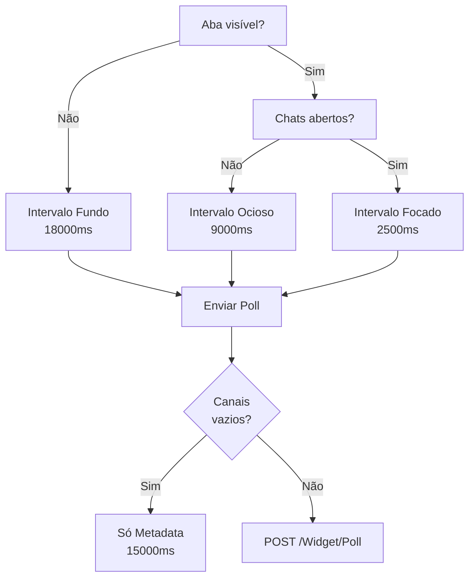

# Fluxo — Polling e Sincronização

> **Audiência:** Desenvolvedor
> **Relacionado:** [Índice de Documentação Técnica](../../README.md)

## O que é

Mecanismo de sincronização assíncrona incremental (long-polling adaptativo) que mantém o widget de chat atualizado em tempo real sem usar WebSockets, consultando o backend em intervalos dinâmicos conforme o foco e o estado da aba do navegador.

## Atores envolvidos

- **Browser (usuário autenticado)** — executa `glpichat-widget.js`, controla timers de polling e estado local
- **Browser (convidado externo)** — executa `glpichat-guest.js`, fluxo simplificado sem múltiplos canais
- **Backend PHP** — controllers `Widget/Poll`, `Widget/Channels`, `Guest/Sync`, `Widget/Leave`, `Guest/Leave`
- **Banco de dados** — tabelas `rooms`, `messages`, `events`, `participants`, `readstates`

## Visão geral

O diagrama mostra como o intervalo de polling é determinado pelo estado da aba e dos chats abertos. Quando não há canais ativos, o ciclo cai para uma sincronização leve de metadados a cada 15 segundos em vez de enviar o payload completo.

## Passo a passo

### A. Sincronização de metadados (`syncChannelMetadata`)

**Frequência:** a cada 15 segundos enquanto a aba estiver visível (`META_SYNC_MS = 15000ms`).

1. JS chama `GET /plugins/glpichat/Widget/Channels` (opcionalmente com `tickets_id` do chamado em foco na página).
2. Backend retorna lista de chamados vinculados ao usuário: IDs de sala, tipo, status no GLPI, contadores de não lidas e `currentUserId`.
3. JS atualiza o launcher (lista de conversas) sem recarregar o DOM do chatbox aberto.

### B. Polling de mensagens e eventos (`pollChannels`)

**Frequência:** dinâmica — 2500ms, 9000ms ou 18000ms.

1. JS mapeia as salas dos chatboxes abertos no dock.
2. Se a lista estiver vazia, cancela o POST e aguarda o próximo ciclo de metadados.
3. Para cada canal aberto, coleta: `tickets_id`, `room_type`, `after_id` (último `messages.id` carregado), `after_event_id` (último `events.id` carregado).
4. Envia `POST /plugins/glpichat/Widget/Poll` com CSRF token e lista de canais.
5. Backend executa `WHERE rooms_id = ? AND id > ?` em `messages` e `events` (busca incremental por índice).
6. Resposta JSON contém novas mensagens, novos eventos e um CSRF token renovado.
7. JS aplica o delta: renderiza novas mensagens, processa eventos de sistema, atualiza badges e renova o CSRF no estado local.

### C. Fluxo do convidado (`/Guest/Sync`)

O convidado não tem múltiplos canais — usa `GET /plugins/glpichat/Guest/Sync?last_message_id=N&last_event_id=M`.

1. Servidor valida o cookie `glpichat_guest_session` e localiza a sala correspondente.
2. Atualiza `last_activity` e `last_seen` no participante.
3. Retorna delta de mensagens e eventos da sala pública.

### D. Saída de sala

- **Usuário autenticado:** `POST /Widget/Leave` com `tickets_id` e `room_type`. Remove o participante ativo e encerra o polling para aquele canal.
- **Convidado:** `POST /Guest/Leave` via `beforeunload`. Remove a sessão e redireciona para página de encerramento.

## Estado e timing

| Constante | Valor | Ativada quando |
|-----------|-------|----------------|
| `POLL_FOCUSED_MS` | 2500ms | Aba visível e pelo menos um chatbox aberto |
| `POLL_IDLE_MS` | 9000ms | Aba visível, mas todos os chatboxes minimizados |
| `POLL_BG_MS` | 18000ms | Aba em segundo plano (Page Visibility API) |
| `META_SYNC_MS` | 15000ms | Aba visível (independente de chats abertos) |

A Page Visibility API (`document.visibilitychange`) controla a transição entre `POLL_FOCUSED_MS`/`POLL_IDLE_MS` e `POLL_BG_MS`. Ao retornar ao foco, o polling se reajusta automaticamente ao intervalo correto.

O CSRF token é renovado a cada resposta de polling — sem necessidade de refresh de página em sessões longas.

## Riscos e pontos de atenção

**Limite de 20 canais por ciclo:** O loop de polling restringe a lista de canais enviados por requisição a no máximo 20. Em usuários com muitas janelas antigas abertas simultaneamente, canais além do 20º não recebem atualização naquele ciclo.

**Race condition com duas abas abertas:** Se o mesmo usuário abrir o GLPI em duas abas simultaneamente, ambas farão polling independente e podem atualizar o `last_read_messages_id` em `readstates` de forma concorrente. O badge de não lidas pode ficar inconsistente entre as abas até o próximo ciclo de metadados.

**Servidor mais lento que o intervalo:** Se o backend demorar mais que `POLL_FOCUSED_MS` (2500ms) para responder, a resposta anterior ainda não chegou quando o próximo timer dispara. O JS não faz requisições sobrepostas — ele aguarda a resposta antes de agendar o próximo ciclo. Isso significa que sob alta latência o intervalo efetivo é `POLL_FOCUSED_MS + tempo de resposta`, não `POLL_FOCUSED_MS`.

**CSRF expirado em sessões muito longas:** Embora o CSRF seja renovado a cada resposta, se o usuário deixar o GLPI aberto sem nenhuma requisição (ex: aba sem chats em segundo plano por muito tempo), o token pode expirar antes do próximo polling. O JS trata o erro 403 reiniciando o ciclo de bootstrap.

**Convidado sem detecção de inatividade no cliente:** O `glpichat-guest.js` não implementa detecção de inatividade local — a expiração de sessão do convidado é detectada apenas pelo backend (via `last_activity`) e comunicada como evento `invite_revoked` no próximo `GET /Guest/Sync`.

 

  ━━━━━━━━━━━━━━━━━━━━━━━ 
  Curtiu o plugin? Deixe uma ⭐ no repositório para ajudar outros administradores a encontrá-lo. 
  Desenvolvido e mantido com apoio de <a href="https://www.forq.com.br/">Forq</a>

