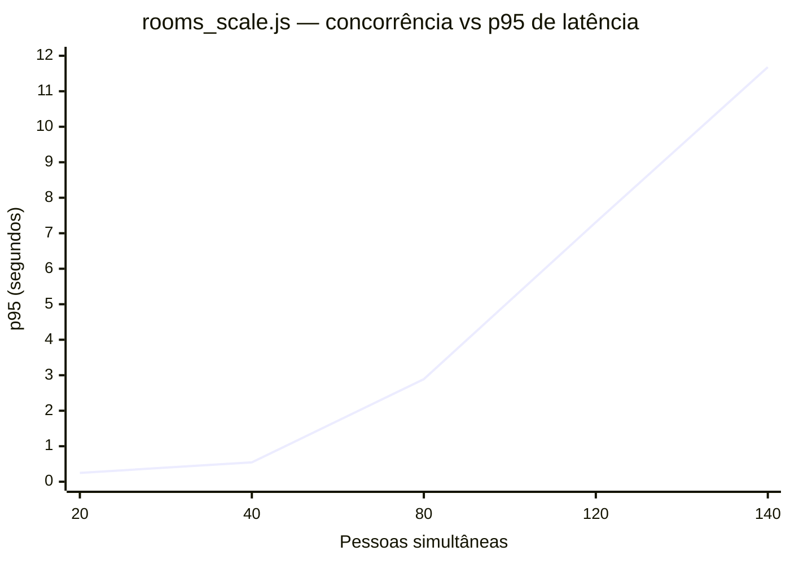

# Performance — Testes de Carga (k6)

> **Audiência:** Desenvolvedor / Administrador técnico
> **Relacionado:** [docs/README.md](../../README.md) · [tests/performance/README.md](../../../tests/performance/README.md)

## O que é

A suíte de testes de carga do plugin (k6, em `tests/performance/k6/`), o que cada cenário mede em termos de capacidade real do sistema, e o que uma execução real contra uma instância GLPI local revelou sobre os limites de concorrência do chat.

Este documento **não repete** as variáveis de ambiente de cada script — isso já está descrito em detalhe no [`tests/performance/README.md`](../../../tests/performance/README.md). Aqui o foco é: o que os números significam e como interpretá-los.

## Visão geral da suíte

9 scripts em `tests/performance/k6/`, cada um isolando um aspecto diferente de carga:

| Script | O que mede |
|---|---|
| `chat_polling.js` | Baseline de polling leve (`Widget/Poll` + `Guest/Sync`) em taxa constante |
| `polling_breakpoint.js` | Teto de `Widget/Poll` sob rampa — **ver limitação metodológica abaixo** |
| `guest_polling_breakpoint.js` | Teto de `Guest/Sync` sob rampa — confiável, sessões guest distintas |
| `rooms_scale.js` | N salas/pessoas simultâneas com sessões distintas — cenário mais confiável de concorrência real |
| `message_throughput.js` | Throughput de `Send`/`Guest/Send` — lado agente sofre a mesma limitação metodológica |
| `upload_throughput.js` | Uploads concorrentes (agente e convidado) |
| `guest_onboarding_burst.js` | Rate limit de aceite de convite (10 tentativas/60s por IP) sob rajada |
| `realistic_mix.js` | Mix ponderado de tráfego: 80% poll / 15% send / 4% mark-read / 1% upload |
| `soak.js` | Carga sustentada de longa duração, para detectar degradação/vazamento |

## Resultados reais (execução de 2026-07-01)

Execução contra instância local Docker (`glpi/glpi:11` + MySQL) — ver [seção de ambiente](#ambiente-de-teste) para as condições exatas.

**Baseline (`chat_polling.js`)**: 100% de sucesso, p95 ~31ms a 4 req/s por canal.

**`Guest/Sync` sob rampa (`guest_polling_breakpoint.js`)**: aguenta 200 req/s com 0% de erro. A cauda de latência sobe no topo da rampa, mas permanece dentro do threshold de 800ms.

**`Upload`/`Guest/Upload`**: 100% de sucesso até 4 uploads concorrentes, p95 ~2.37s. Latência esperada — é I/O de disco mais gravação de documento, operação de escrita pesada por natureza.

### Curva de escala de pessoas simultâneas (`rooms_scale.js`)

Sessões distintas de convidado por pessoa, mensagem sendo enviada por cada uma (sem o poll do agente — ver [riscos](#riscos-e-pontos-de-atenção)):

| Pessoas simultâneas | Taxa de erro | p95 de latência | Throughput agregado |
|---|---|---|---|
| 20  | 0% | 248ms | 13.8 req/s |
| 40  | 0% | 545ms | 13.8 req/s |
| 80  | 0% | 2.89s | 26.3 req/s |
| 120 | 0% | 7.31s | 22.2 req/s |
| 140 | 0% | 11.68s (máx 54.17s) | 17.1 req/s (**caindo**) |

Observe duas inflexões na curva: entre **40 e 80 pessoas**, o p95 salta de ~0.5s para quase 3s — é aqui que a experiência de chat deixa de ser boa e passa a ser perceptivelmente lenta. Entre **120 e 140 pessoas**, o throughput agregado começa a **cair** (de 22.2 para 17.1 req/s) mesmo com mais VUs ativos — esse é o sinal característico de saturação real de CPU do host, não apenas fila crescendo.

### Conclusão de capacidade

Nenhum erro HTTP apareceu em nenhum ponto testado, até 140 pessoas simultâneas — o sistema nunca "quebrou" sob essas condições, apenas degradou latência progressivamente. Como guia prático (neste ambiente específico):

- **Boa experiência** (p95 < ~600ms): até ~40 pessoas simultâneas.
- **Aceitável mas perceptível** (p95 ~2-3s): até ~80 pessoas.
- **Acima de 120-140**: a saturação de CPU do host (12 cores, Apache prefork com `MaxRequestWorkers 150`) já é o fator limitante. Não é falta de memória — RAM sobrou o tempo todo — nem, até onde testado, um limite de código do plugin.

## Ambiente de teste

Os números acima **não são portáteis para qualquer hardware** — são específicos deste ambiente:

- Container `glpi` (`glpi/glpi:11`), Apache MPM `prefork`, `MaxRequestWorkers 150`.
- Container `glpi-db` (MySQL).
- Nenhum limite de CPU/memória configurado nos containers — podem usar todo o host.
- Host de teste: 12 cores de CPU, 31GB RAM. Uso real de memória durante os testes ficou abaixo de 1%.

Mais cores de CPU no host tenderiam a elevar o teto de concorrência observado, já que RAM não foi o gargalo em nenhum momento da execução.

## Como rodar

A suíte completa é executada via `./tests/performance/run_k6.sh <base_url> [script.js] [args extras do k6]`. Cada script exige suas próprias variáveis de ambiente (`GLPICHAT_*`) para autenticação de agente/convidado e parâmetros de rampa — todas documentadas por script em [`tests/performance/README.md`](../../../tests/performance/README.md). Logs de cada execução (stdout completo e resumo JSON) ficam em `tests/performance/logs/`, que é ignorado pelo git.

## Riscos e pontos de atenção

**Limitação metodológica: `polling_breakpoint.js` e o lado agente de `message_throughput.js`/`realistic_mix.js`/`soak.js`.** Esses cenários rampeiam muitos VUs contra **uma única sessão/cookie de agente** (o simulador só autentica 1 agente). Isso foi confirmado como artefato de teste via `curl` concorrente direto, fora do k6: requisições concorrentes que compartilham o mesmo `PHPSESSID` do PHP **serializam** por causa do lock de arquivo de sessão nativo do PHP — 5 chamadas a `Send` concorrentes na mesma sessão executam sequencialmente (1.1s, 2.2s, 3.3s, 4.4s, 5.5s), nunca em paralelo de verdade.

Isso nunca acontece em produção real — cada agente logado tem sua própria sessão e portanto seu próprio lock. Consequência prática: os números de "teto de req/s" desses cenários específicos (lado widget/agente) **não devem ser usados para decisão de capacidade real**. Eles só servem para detectar regressão de latência de um único agente ao longo do tempo (ex: comparar execuções antes/depois de uma mudança de código). Os únicos cenários com números de capacidade confiáveis, por usarem sessões distintas de verdade, são `guest_polling_breakpoint.js` e `rooms_scale.js`.

**Lacuna de cobertura conhecida.** `Widget/Poll` aceita até 20 canais por requisição — na vida real um agente não faz N requisições individuais para N tickets abertos, faz poucas requisições em lote. Nenhum script hoje simula esse padrão de uso em lote; um teste de capacidade real do lado agente (com múltiplas sessões distintas E poll em lote) ainda não existe nesta suíte.

 

  ━━━━━━━━━━━━━━━━━━━━━━━ 
  Curtiu o plugin? Deixe uma ⭐ no repositório para ajudar outros administradores a encontrá-lo. 
  Desenvolvido e mantido com apoio de <a href="https://www.forq.com.br/">Forq</a>

